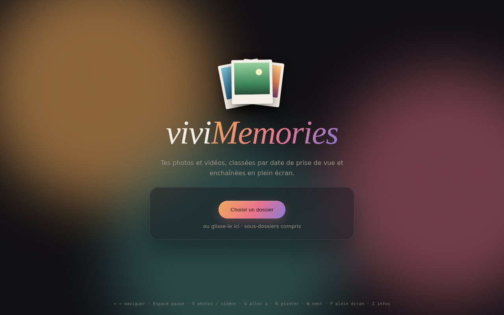

# viviMemories

Photos et vidéos d'un dossier (sous-dossiers compris), classées par date de prise de vue et enchaînées en plein écran.

**Essayer en ligne : <https://vivien7806.github.io/viviMemories/>**. Tout se passe dans le navigateur : les fichiers
ne quittent pas l'ordinateur. Seul ffmpeg.wasm est téléchargé, si une vidéo l'exige.



Un seul code TypeScript, deux versions : une page web autonome (`dist/web/index.html`) et une application Electron,
qui ajoute l'ouverture par clic droit, ffmpeg natif et les corrections de vidéos.

## Vidéos

Ce que le navigateur lit (H.264, VP9, AV1) passe directement. Le reste est lu à la volée, pendant sa conversion :
la vidéo démarre tout de suite, sans attendre la fin.

- **Conteneur illisible** (`.mts`, `.avi`, `.flv`… en H.264) : image copiée sans perte. Une copie `.mp4` complète est
  préparée pendant la lecture, puis proposée pour remplacer l'original.
- **Codec illisible** (MPEG-2 des `.mpg`/`.vob`, DV, DivX, WMV, HEVC…), ou copie encore illisible (certains `.mp4`) :
  réencodage pendant la lecture.
- **Rotation (R)** sans réencodage, et **filtre anti-vent (W)**, pour les `.mp4`/`.mov`, après aperçu et confirmation
  (application seulement).

Electron utilise ffmpeg natif et prépare d'avance les vidéos voisines. La version web essaie d'abord sans rien
télécharger : démuxage en JS ([Mediabunny](https://mediabunny.dev)) et réencodage matériel avec WebCodecs. Sinon
(`.avi`, MPEG-2, son AC-3…), elle télécharge ffmpeg.wasm (~30 Mo). Servie avec les en-têtes
`Cross-Origin-Opener-Policy: same-origin` et `Cross-Origin-Embedder-Policy: require-corp` (c'est le cas de
`npm run dev`), la page est isolée et ffmpeg.wasm utilise plusieurs cœurs, environ 3 fois plus vite. GitHub Pages
n'envoie pas ces en-têtes : la version en ligne les ajoute avec un service worker
([coi-serviceworker](https://github.com/gzuidhof/coi-serviceworker)). En `file://`, ffmpeg.wasm reste sur un seul cœur.

## Raccourcis

← → naviguer · Espace pause · V photos / vidéos · G aller à un numéro ou une date · + / − vitesse ·
F plein écran · Échap fermer · I infos de lecture · R pivoter · W vent

## Développer

Prérequis : Node.js 22+.

```sh
npm install
npm start [-- ~/Images/Vacances]   # application Electron
npm run dev                        # version web : http://localhost:5173
npm test                           # tests unitaires
npm run test:e2e                   # tests Playwright (avant : npx playwright install chromium)
npm run build:pages                # version en ligne, dans dist/web
```

`npm run test:e2e` met aussi à jour la capture `docs/accueil.jpg`. Chaque push sur `main` publie la version web sur
GitHub Pages (`.github/workflows/pages.yml`).

## Installer

- **Windows**, construit depuis WSL avec Docker : `npm run dist:win:docker`, puis `./release/viviMemories\ Setup\ *.exe`.
  SmartScreen prévient que l'application n'est pas signée (« Informations complémentaires », « Exécuter quand
  même »). Le clic droit sur un dossier propose ensuite « Ouvrir avec viviMemories ».
- **Linux** : `npm run dist:linux`, puis `sudo apt install ./release/vivimemories_*_amd64.deb`, ou l'AppImage sans
  installation.

## Notes

- Sous Linux, le ffmpeg du système est utilisé s'il est installé : celui de `ffmpeg-static` plante sur les MPEG-TS.
  `VIVIMEMORIES_FFMPEG=/chemin/ffmpeg` force un binaire précis.
- Sous WSL, Chromium n'a pas de décodage vidéo matériel : les vidéos lourdes y saccadent, pas sous Windows.
  `--gpu-info` ouvre `chrome://gpu`.
- L'icône est `build/icon.svg`, exportée en `build/icon.png` (512×512) pour electron-builder.

## Licence

[GPL-3.0-or-later](LICENSE). L'application embarque ffmpeg (GPL) ; la version web utilise
[Mediabunny](https://mediabunny.dev) (MPL-2.0) et télécharge [ffmpeg.wasm](https://github.com/ffmpegwasm/ffmpeg.wasm).
